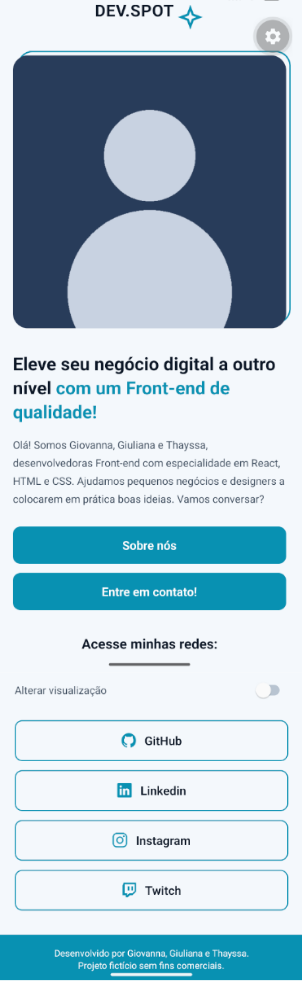
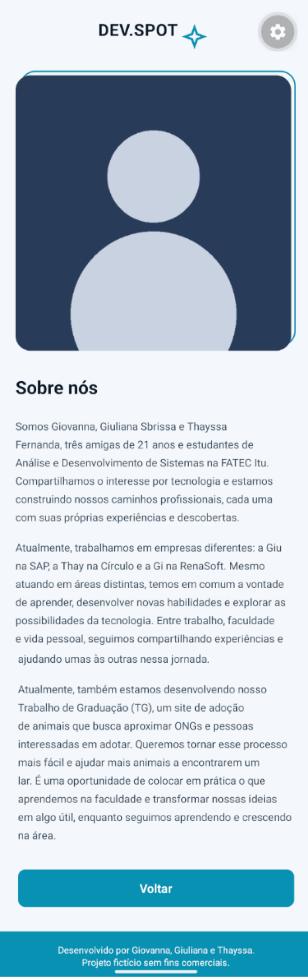

# DEV.SPOT – App Expo + React Native (TypeScript)

**Projeto Bimestral** – Professor Melkie

## Integrantes

- Giovanna Membrive
- Giuliana Sbrissa
- Thayssa Fernanda Rebeiro Santos

## Descrição

O DEV.SPOT é um aplicativo mobile desenvolvido com **Expo**, **React Native** e **TypeScript**. Ele reproduz o layout de um portfólio de desenvolvedora Front-end e tem duas telas:

- **Home:** logo, foto de perfil, apresentação, botões de ação, switch de visualização e links para as redes sociais (GitHub, LinkedIn, Instagram e Twitch).
- **Sobre mim:** título, biografia e rodapé com créditos.

### Funcionalidades

- Navegação entre telas com React Navigation (stack).
- Botão "Sobre mim" que leva para a segunda tela.
- Botão "Entre em contato!" que exibe um Alert com a mensagem "Entre em contato".
- Switch que exibe um Alert com a mensagem "Switch pressionado".
- Botões de redes sociais que abrem os links reais.
- Componentes reutilizáveis e estilização com `StyleSheet`.

## Prints das telas

| Home | Sobre mim |
| :---: | :---: |
|  |  |

## Tecnologias

- [Expo](https://expo.dev/)
- [React Native](https://reactnative.dev/)
- [TypeScript](https://www.typescriptlang.org/)
- [React Navigation](https://reactnavigation.org/) (`@react-navigation/native` e `@react-navigation/native-stack`)
- [@expo/vector-icons](https://docs.expo.dev/guides/icons/)

## Estrutura do projeto

```
proj-bim/
├── App.tsx                      # Ponto de entrada e configuração da navegação
├── index.ts
├── app.json
├── package.json
├── tsconfig.json
└── src/
    ├── assets/
    │   └── perfil.png           # Foto de perfil
    ├── components/
    │   ├── Header.tsx           # Logo DEV.SPOT com ícone
    │   ├── Footer.tsx           # Rodapé com os créditos
    │   ├── ProfileImage.tsx     # Foto com moldura em destaque
    │   ├── PrimaryButton.tsx    # Botão principal preenchido
    │   └── SocialButton.tsx     # Botão de rede social com ícone e link
    ├── screens/
    │   ├── HomeScreen.tsx       # Tela 1 – Home
    │   └── AboutScreen.tsx      # Tela 2 – Sobre mim
    └── theme.ts                 # Cores e espaçamentos
```

## Como rodar o projeto

**Pré-requisitos:** Node.js instalado e o app **Expo Go** no celular (ou um emulador Android/iOS).

1. Clone o repositório:
```bash
   git clone URL_DO_REPOSITORIO
   cd proj-bim
```
2. Instale as dependências:
```bash
   npm install
```
3. Inicie o projeto:
```bash
   npx expo start
```
4. Abra o app:
   - Escaneie o QR Code com o **Expo Go**, ou
   - Pressione `a` para abrir no emulador Android, ou
   - Pressione `w` para abrir no navegador.

> Se aparecer algum erro de módulo não encontrado, rode `npx expo install` para ajustar as dependências e depois `npx expo start -c` para limpar o cache.

---

Projeto fictício desenvolvido para fins acadêmicos, sem fins comerciais.
